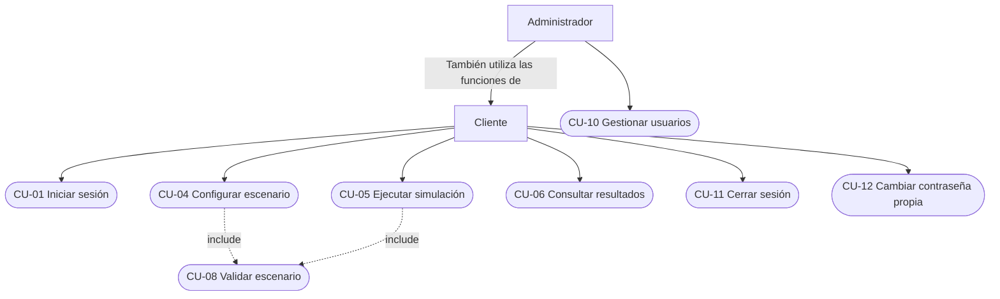
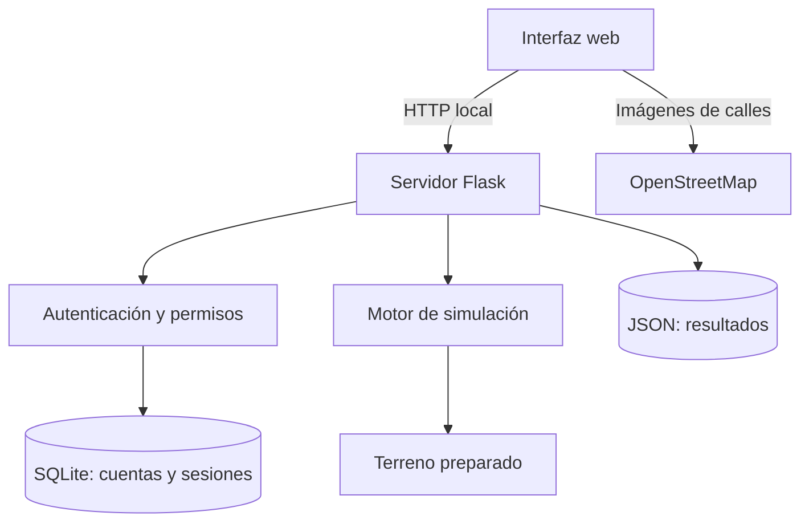

# Pluvia SCZ

**Documentación funcional y técnica · Sprint 1**

## 1. Descripción del proyecto

Pluvia SCZ es una aplicación web local para explorar la acumulación de agua de lluvia en una zona de Santa Cruz de la Sierra. El usuario define un escenario de lluvia, humedad del suelo y drenaje; el sistema calcula la respuesta del terreno y representa los resultados sobre un mapa. Cada ejecución se guarda y puede consultarse desde el historial de la cuenta.

El terreno se representa mediante 576 celdas de 250 × 250 metros, distribuidas en una cuadrícula de 24 × 24. El cálculo abarca 36 km². Los indicadores resumen las 256 celdas centrales, equivalentes a 16 km²; el margen exterior también participa en el movimiento del agua.

Los resultados describen la respuesta de un modelo simplificado ante condiciones elegidas por el usuario. **No son un pronóstico meteorológico ni una medición de inundaciones reales.** El sistema permite estudiar cómo cambian las acumulaciones bajo esos supuestos, sin determinar la seguridad de una calle o vivienda.

## 2. Usuarios y permisos

El acceso requiere una cuenta local. El **cliente** configura escenarios, ejecuta simulaciones y consulta sus resultados. El **administrador** dispone de esas funciones y gestiona las cuentas y el acceso al historial completo.

| Función | Cliente | Administrador |
|---|---|---|
| Iniciar y cerrar sesión | Sí | Sí |
| Cambiar su contraseña | Sí | Sí |
| Explorar el terreno y la ayuda | Sí | Sí |
| Configurar y ejecutar simulaciones | Sí | Sí |
| Consultar resultados propios | Sí | Sí |
| Consultar resultados de otras cuentas | No | Sí |
| Consultar resultados sin propietario | No | Sí |
| Crear cuentas y asignar roles | No | Sí |
| Activar o desactivar cuentas | No | Sí |
| Restablecer contraseñas de usuarios | No | Sí |

El servidor comprueba el rol y el propietario antes de devolver un resultado. El nombre de usuario identifica la cuenta; el rol determina sus permisos. Siempre debe existir al menos un administrador activo.

<!-- salto -->

## 3. Casos de uso

El diagrama reúne las funciones de acceso, simulación y consulta. El administrador puede realizar las operaciones del cliente. El motor de cálculo forma parte de la aplicación y no actúa como un servicio externo.



**Relaciones.** CU-04 y CU-05 utilizan la validación de parámetros de CU-08. El formulario aplica restricciones de entrada y el servidor realiza la validación completa al ejecutar. En CU-06, el cliente consulta sus resultados y el administrador puede consultar todos.

La sesión activa es una precondición de las operaciones protegidas. No es necesario repetir el inicio de sesión para cada acción. Los códigos identifican cada caso de uso y se mantienen como referencias del proyecto.

<!-- salto -->

### CU-01 · Iniciar sesión

**Actor:** cliente o administrador. **Precondición:** aplicación iniciada y cuenta activa.

1. El usuario abre la página de acceso e introduce su usuario y contraseña.
2. El servidor verifica las credenciales y el estado de la cuenta.
3. El sistema crea la sesión y muestra el simulador, junto con el nombre y rol del usuario.

**Alternativas:** las credenciales incorrectas o una cuenta desactivada producen un mensaje de acceso rechazado. Diez intentos fallidos por dirección IP dentro de quince minutos limitan nuevos intentos hasta que se libere la ventana de control.

**Resultado:** sesión autenticada con una duración máxima de ocho horas desde el ingreso.

### CU-04 · Configurar escenario

**Actor:** cliente o administrador. **Precondición:** sesión activa y formulario disponible.

1. El usuario selecciona un ejemplo o introduce lluvia total, duración, humedad y drenaje.
2. El formulario muestra la intensidad de lluvia y aplica las restricciones de entrada.
3. El usuario corrige los valores que no cumplen los límites.

**Alternativas:** si ya existe un resultado visible y se modifican los parámetros, el sistema indica que el mapa conserva la ejecución anterior hasta volver a simular.

**Resultado:** configuración preparada para ejecutar. Los parámetros se almacenan junto con el resultado cuando se realiza CU-05.

### CU-08 · Validar escenario

**Invocación:** CU-04 y CU-05. **Precondición:** parámetros ingresados en el formulario o recibidos por la API.

1. Se comprueba la presencia de los cuatro parámetros del escenario.
2. Se verifica que los valores sean numéricos, finitos y estén dentro de sus límites.
3. El servidor acepta la configuración o devuelve la explicación del error.

**Alternativas:** se rechazan campos desconocidos, datos ausentes y valores booleanos usados como números. Un identificador de propietario enviado como parte del escenario también es un campo no admitido.

**Resultado:** configuración válida para el cálculo o solicitud rechazada. Los intervalos se detallan en la sección 5.

<!-- salto -->

### CU-05 · Ejecutar simulación

**Actor:** cliente o administrador. **Precondiciones:** sesión activa, territorio cargado y escenario configurado.

1. El usuario pulsa **Simular**.
2. El servidor comprueba la sesión, el token del formulario y los parámetros del escenario.
3. El motor calcula la lluvia, infiltración, drenaje y transferencia de agua entre celdas.
4. El servidor asigna el propietario a partir de la sesión y guarda una ejecución con identificador único.
5. La interfaz muestra el mapa de índice relativo, los indicadores y la confirmación del guardado.

**Alternativas:** una entrada inválida se rechaza antes del cálculo. Una sesión vencida requiere volver a ingresar. Si el cálculo o el guardado falla, la interfaz no confirma una ejecución guardada.

**Resultado:** archivo de simulación asociado a la cuenta, con parámetros, matrices, resumen y versiones de los datos y del motor. Cada ejecución crea un archivo distinto.

### CU-06 · Consultar resultados

**Actor:** cliente o administrador. **Precondiciones:** sesión activa y ejecución accesible para la cuenta.

1. El usuario abre **Mis resultados** o **Todos los resultados**, según su rol.
2. Selecciona una ejecución de la lista.
3. El servidor comprueba el permiso y recupera el resultado guardado.
4. La interfaz restaura los parámetros y permite consultar capas, celdas e indicadores.

**Alternativas:** una lista vacía indica que no hay resultados accesibles. Una ejecución ajena a un cliente se trata como no encontrada. Los archivos dañados se omiten del historial y se conservan; el administrador recibe el aviso de los archivos omitidos.

**Resultado:** visualización de una ejecución sin repetir el cálculo. La lista contiene hasta las 100 ejecuciones accesibles más recientes; ese límite no elimina archivos.

<!-- salto -->

### CU-10 · Gestionar usuarios

**Actor:** administrador. **Precondición:** sesión activa con rol administrador.

1. El administrador abre **Usuarios**.
2. Para crear una cuenta, introduce nombre, usuario, rol y contraseña inicial.
3. Para modificar una cuenta, selecciona su rol, estado de acceso o una nueva contraseña.
4. El servidor valida y guarda la operación. Los cambios efectivos de rol, estado o contraseña cierran las sesiones de la cuenta afectada.

**Alternativas:** se rechazan usuarios duplicados, roles inválidos y contraseñas fuera de longitud. También se impide desactivar o retirar el rol al último administrador activo. Dejar vacío el campo de restablecimiento conserva la contraseña existente.

**Resultado:** cuenta creada o actualizada. Desactivar el acceso conserva sus resultados.

### CU-11 · Cerrar sesión

**Actor:** cliente o administrador. **Precondición:** sesión activa.

1. El usuario pulsa **Salir**.
2. El servidor valida la solicitud e invalida la sesión.
3. La aplicación vuelve a la página de acceso.

**Alternativas:** si la sesión ya venció, el usuario debe volver a ingresar; un token de formulario inválido exige recargar la página.

**Resultado:** la sesión anterior ya no permite acceder a los datos protegidos.

### CU-12 · Cambiar contraseña propia

**Actor:** cliente o administrador. **Precondición:** sesión activa y conocimiento de la contraseña actual.

1. El usuario abre **Mi cuenta** e introduce la contraseña actual, la nueva y su confirmación.
2. El servidor verifica los datos y guarda el nuevo hash de contraseña.
3. Se cierran todas las sesiones de la cuenta y se muestra la página de acceso.

**Alternativas:** contraseña actual incorrecta, confirmación diferente o longitud no válida: se rechaza el cambio sin modificar la cuenta.

**Resultado:** el usuario vuelve a ingresar con la nueva contraseña. El restablecimiento de otra cuenta corresponde a CU-10.

<!-- salto -->

## 4. Uso del sistema

### 4.1 Acceso

Iniciar el servidor siguiendo la sección 8 y abrir **http://127.0.0.1:5050**. Introducir las credenciales locales creadas para Pluvia SCZ. La cabecera muestra el nombre, el rol, **Mi cuenta** y **Salir**; el administrador también dispone de **Usuarios**.

### 4.2 Ejecutar un escenario

1. Elegir el ejemplo de **50 mm** o **100 mm**, o ajustar los cuatro parámetros del panel izquierdo. Los ejemplos utilizan dos horas, humedad intermedia y drenaje de 5 mm/h.
2. Revisar la intensidad calculada y pulsar **Simular**. Cargar un ejemplo no ejecuta el cálculo automáticamente.
3. Esperar el mensaje de resultado calculado y guardado. Los controles de entrada y el historial se bloquean durante el cálculo.
4. Seleccionar la capa que se desea consultar y pulsar una celda para ver sus valores.

### 4.3 Explorar el mapa

| Control | Uso |
|---|---|
| Capa del mapa | Alterna entre altura del terreno, índice relativo y agua máxima simulada. Las capas de resultados se habilitan al cargar una ejecución. |
| Mapa con calles | Muestra el fondo OpenStreetMap y permite desplazarse y hacer zoom. Requiere conexión. |
| Vista sin internet | Representa el mismo terreno y los resultados mediante una cuadrícula local. |
| Centrar zona | Ajusta el mapa con calles a la extensión del piloto. |
| Mostrar cuadrícula | Activa o desactiva las líneas internas de las celdas. |
| Opacidad | Cambia la transparencia de la capa, sin alterar sus valores. |
| Ficha de celda | Muestra ubicación, altura, agua máxima e índice. Indica si pertenece al reporte o al margen. |

### 4.4 Historial, ayuda y cuentas

Para recuperar una ejecución, abrir **Mis resultados** como cliente o **Todos los resultados** como administrador y seleccionarla. El mapa y los parámetros corresponden a esa ejecución. Si luego se editan las entradas, hay que pulsar **Simular** para obtener otro resultado.

**Ayuda**, los botones **i** y **Interpretar** explican las entradas, capas y fuentes. El panel se cierra con su botón o con Escape.

El administrador crea cuentas desde **Usuarios**. El usuario de acceso admite entre 3 y 40 letras sin tildes, números, puntos, guiones o guiones bajos; se guarda en minúsculas. El nombre admite hasta 80 caracteres y la contraseña entre 12 y 128. Cada persona puede cambiar su contraseña desde **Mi cuenta**.

<!-- salto -->

## 5. Interpretación del mapa y los resultados

### Parámetros del escenario

| Parámetro | Significado | Valores |
|---|---|---|
| Lluvia total | Cantidad acumulada durante el evento. Un milímetro equivale a un litro por metro cuadrado. | 0 a 300 mm |
| Duración | Tiempo durante el que se reparte uniformemente la lluvia. | 0,1 a 24 horas |
| Humedad inicial | Saturación que reduce la infiltración del suelo. La interfaz ofrece seco, intermedio y saturado. | 0; 0,5; 1. La API admite valores entre 0 y 1. |
| Drenaje hipotético | Tasa uniforme de retiro de agua disponible; no es una medición de la red municipal. | 0 a 100 mm/h |

La intensidad es lluvia total dividida entre duración. Por ejemplo, **50 mm en dos horas equivalen a 25 mm/h**. Una mayor humedad deja menos capacidad de infiltración en el modelo.

### Capas e indicadores

**Altura del terreno:** elevación media de cada celda, expresada en metros. El piloto contiene valores aproximados de 399,65 a 421,23 m. Los decimales no indican precisión centimétrica ni describen el desnivel de cada calle.

**Agua máxima simulada:** mayor lámina equivalente calculada en una celda durante el evento, en milímetros. Puede superar la lluvia local cuando recibe agua de otras celdas. Los máximos de distintas celdas pueden ocurrir en momentos diferentes.

**Índice relativo:** valor de agua máxima limitado al intervalo de 0 a 100. Es una escala de acumulación simulada, no una probabilidad.

| Categoría | Índice |
|---|---|
| Baja | Desde 0 hasta menos de 25 |
| Media | Desde 25 hasta menos de 50 |
| Alta | Desde 50 hasta menos de 75 |
| Muy alta | Desde 75 hasta 100 |

**Ejemplo de lectura:** 40 mm de agua máxima producen 40 puntos. Tanto 100 mm como 180 mm producen 100 puntos; la capa de agua máxima permite distinguirlos. Un índice de 80 no significa un 80 % de probabilidad de inundación.

El resumen presenta la mayor acumulación y el índice medio del área central de 16 km². Un color claro indica menor acumulación calculada, no ausencia de riesgo. El contorno discontinuo delimita el reporte; el margen exterior sigue interviniendo en la simulación.

<!-- salto -->

## 6. Funcionamiento técnico

### 6.1 Arquitectura



El navegador presenta el formulario y dibuja el mapa mediante JavaScript, SVG y Leaflet. Flask entrega las páginas y los datos, comprueba los permisos e invoca el motor Python. NumPy opera sobre las matrices del terreno y del agua. Las imágenes de calles sirven como referencia visual y no participan en el cálculo.

### 6.2 Cálculo del agua

La simulación comienza sin agua almacenada y utiliza pasos de aproximadamente 30 segundos, ajustados para completar la duración exacta del evento. En cada paso:

1. Agrega la fracción de lluvia correspondiente a todas las celdas.
2. Retira infiltración y drenaje, limitados al agua disponible.
3. Registra la acumulación máxima y calcula la carga de cada celda: elevación del terreno más altura de agua.
4. Transfiere agua hacia los vecinos norte, sur, este y oeste de menor carga. Limita conjuntamente las salidas para no retirar más agua que la disponible.
5. Actualiza los máximos y comprueba el balance del dominio.

La infiltración efectiva es `5 × (1 − saturación)` mm/h. La transferencia usa una conductancia sintética de 20 m²/s. El borde exterior está cerrado y la ventana de cálculo termina cuando cesa la lluvia.

El balance compara **agua inicial + lluvia − infiltración − drenaje** con el almacenamiento final. Los intercambios internos se compensan al sumar el dominio. Esta comprobación verifica la conservación numérica; no demuestra exactitud frente a una inundación observada.

La lluvia y las tasas de retiro son uniformes. La cuadrícula de 250 m representa el relieve agregado, sin resolver tuberías, cunetas ni desbordamiento del río Piraí. Estas condiciones determinan el alcance de los resultados.

<!-- salto -->

### 6.3 API y control de acceso

| Método y ruta | Función |
|---|---|
| `GET /` | Página del simulador; requiere sesión. |
| `GET /api/territory` | Manifiesto territorial, geometría de celdas e indicador de Leaflet local. |
| `POST /api/simulate` | Valida, calcula y guarda una ejecución; devuelve el resultado con estado 201. |
| `GET /api/runs` | Lista hasta 100 resultados accesibles recientes. |
| `GET /api/runs/{run_id}` | Recupera el contenido completo de una ejecución permitida. |
| `GET /login` y `POST /login` | Formulario y autenticación de la cuenta. |
| `POST /logout` | Cierra la sesión. |
| `GET /account` y `POST /account` | Muestra la cuenta y procesa el cambio de contraseña. |
| `GET /admin/users` y `POST /admin/users` | Lista y crea cuentas; acceso exclusivo del administrador. |
| `POST /admin/users/{id}` | Modifica rol, estado o contraseña de una cuenta. |

Las rutas de datos requieren una sesión válida. La interfaz consulta `/api/runs?include_warnings=1` para recibir `runs` y `warnings`; los nombres de archivos omitidos se informan únicamente al administrador.

El cuerpo JSON de una simulación contiene exactamente estos parámetros:

```json
{"rain_mm": 50, "duration_h": 2, "saturation": 0.5, "drainage_mmh": 5}
```

Los formularios de escritura utilizan un token CSRF; la solicitud de simulación lo envía en `X-CSRF-Token`. Este token comprueba que la solicitud corresponde al formulario de la sesión. El tamaño máximo del cuerpo de petición es 4096 bytes.

| Estado HTTP | Significado en la aplicación |
|---|---|
| 400 | Parámetros o datos de formulario inválidos. |
| 401 | Credenciales rechazadas o sesión ausente o vencida en la API. |
| 403 | Permiso insuficiente o token CSRF inválido. |
| 404 | Ejecución inexistente, identificador inválido o resultado ajeno a un cliente. |
| 422 | Resultado dañado o incompleto al consultarlo como administrador. |
| 429 | Límite de intentos de inicio de sesión alcanzado. |

Las contraseñas se almacenan mediante hashes scrypt con sal. La cookie está firmada y utiliza HttpOnly y SameSite=Lax. El servidor conserva el hash del identificador de sesión y su vencimiento, y comprueba la cuenta activa en cada petición. Cerrar sesión invalida ese identificador; cambiar contraseña, rol o estado revoca las sesiones correspondientes.

El servidor escucha en `127.0.0.1:5050`, mediante HTTP local y sin depurador. Las respuestas privadas usan `Cache-Control: no-store`. El acceso corresponde a cuentas de Pluvia SCZ, no a cuentas de Microsoft.

<!-- salto -->

## 7. Datos y almacenamiento

### 7.1 Terreno y mapa base

La elevación procede de **FABDEM V1-2**, tesela `S18W064`, con resolución de origen aproximada de 30 m. La preparación reproyecta el terreno a EPSG:32720 (UTM 20S), recorta el piloto y promedia la elevación a celdas de 250 m. Los datos preparados se distribuyen con el proyecto.

| Archivo | Contenido |
|---|---|
| `data/pilot-v1/territory.npz` | Matrices de elevación, infiltración, pendiente y máscara del área de reporte. |
| `data/pilot-v1/cells.geojson` | Geometría y propiedades de las celdas para el mapa. |
| `data/pilot-v1/manifest.json` | Versión, dimensiones, sistema de coordenadas, fuentes y supuestos. |
| `data/pilot-v1/elevation_250m.tif` | Ráster de elevación agregado. |

OpenStreetMap proporciona las imágenes del fondo de calles. Leaflet gestiona su visualización interactiva. La vista local utiliza SVG y permite consultar terreno y resultados sin solicitar esas imágenes.

### 7.2 Cuentas y resultados

`data/private/accounts.sqlite3` contiene cuatro tablas: `users` (identidad, hash de contraseña, rol y estado), `sessions` (sesiones y vencimiento), `attempts` (control de intentos) y `settings` (clave de firma local).

Cada simulación se guarda en `data/runs/` como un JSON independiente. Incluye identificadores, propietario, fecha UTC, parámetros, versiones, matrices de agua máxima, agua final e índice, balance temporal, resumen y fuentes. El servidor escribe primero un archivo temporal y lo renombra al completar el guardado.

El propietario procede de la sesión autenticada. Los resultados que no tienen propietario son accesibles solo para administradores. La consulta del historial no modifica los archivos guardados.

### 7.3 Respaldo

Detener el servidor y copiar juntas las carpetas `data/private/` y `data/runs/`, junto con el código y el territorio correspondiente. Mantenerlas asociadas conserva la relación entre cuentas y resultados. Ambas carpetas están excluidas de Git; una instalación nueva genera sus propias cuentas y ejecuciones.

### Fuentes y atribución

- **FABDEM V1-2:** Neal, Hawker, Uhe, Paulo, Sosa, Savage y Sampson, Universidad de Bristol. [Dataset y DOI](https://doi.org/10.5523/bris.s5hqmjcdj8yo2ibzi9b4ew3sn). Los derivados de elevación mantienen la licencia [CC BY-NC-SA 4.0](https://creativecommons.org/licenses/by-nc-sa/4.0/); la adaptación comprende recorte, reproyección y promedio a 250 m.
- **Mapa de calles:** © [OpenStreetMap contributors](https://www.openstreetmap.org/copyright). Las imágenes se consultan en línea y no se distribuyen con el proyecto.

<!-- salto -->

## 8. Instalación y ejecución

### 8.1 Requisitos

Python 3.12, un navegador moderno e internet para instalar dependencias. El cálculo y la vista local funcionan con los datos incluidos; el fondo de calles requiere conexión. Los comandos siguientes corresponden a Windows PowerShell. `INICIAR.cmd` y `start.ps1` son iniciadores de Windows.

### 8.2 Instalación desde GitHub

Con Git instalado, ejecutar:

```powershell
git clone https://github.com/Lole67/pluvia-scz.git
cd pluvia-scz
py -3.12 -m venv .venv
.\.venv\Scripts\python.exe -m pip install -r requirements.txt
.\.venv\Scripts\python.exe run.py
```

Si el proyecto se obtiene como ZIP, extraerlo, abrir PowerShell en la carpeta que contiene `run.py` y ejecutar los tres comandos desde la creación del entorno. No es necesario activar el entorno virtual ni descargar nuevamente el terreno original.

### 8.3 Primera cuenta

En el primer arranque, la terminal solicita usuario, nombre, contraseña y confirmación para crear el administrador. La contraseña admite entre 12 y 128 caracteres y no se muestra al escribir. El servidor inicia después de completar estos datos; no hay credenciales predeterminadas.

Cuando aparezca `Running on`, abrir **http://127.0.0.1:5050** e iniciar sesión. Mantener la terminal abierta. El administrador puede crear las demás cuentas desde **Usuarios**.

### 8.4 Arranques posteriores

Abrir PowerShell en la carpeta del proyecto y ejecutar:

```powershell
.\INICIAR.cmd
```

El iniciador busca `.venv` dentro del proyecto y, si no existe, en la carpeta superior. También se puede ejecutar directamente `.\.venv\Scripts\python.exe run.py` cuando el entorno está dentro del proyecto. Para detener el servidor, pulsar **Ctrl+C** en su terminal.

### 8.5 Recuperación de acceso

Un administrador puede restablecer la contraseña de otra cuenta desde **Usuarios**. Para recuperar el acceso desde el equipo local, ejecutar en la carpeta del proyecto:

```powershell
.\.venv\Scripts\python.exe scripts/reset_password.py
```

La utilidad pide el usuario, la nueva contraseña y su confirmación; reactiva la cuenta y cierra sus sesiones anteriores. Si el entorno está en la carpeta superior, sustituir `.\.venv` por `..\.venv`. La recuperación conserva el rol y los resultados.
